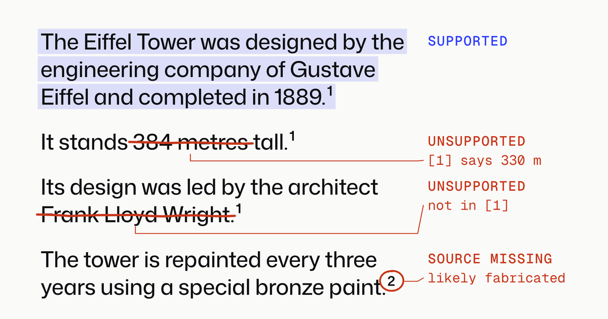

# upheld

upheld checks the citations in an AI answer against the pages they cite.

Point it at an answer from ChatGPT, Perplexity, Gemini or a RAG pipeline. It reads every cited page and says which claims the sources back. Runs locally: no API key.



Try it: `pip install "upheld[models]"` · [Site](https://upheld.varunsg.com) · [Benchmarks](#how-good-is-it) · [Limitations](#known-limitations)

[](https://github.com/warun7/upheld/actions/workflows/ci.yml)

AI search tools and deep-research agents now mostly cite real, working links, but the cited page often doesn't say what the answer claims: [one 2026 study](https://arxiv.org/abs/2605.06635) of 14 models found only 39–77% of cited facts were actually in the source. Link checkers can't see it. upheld splits an answer into claims, finds the relevant passage in each cited source, and says which claims the sources really back.

## How it's meant to be used

One engine, several ways in. They all call the same `run_audit()`.

| Surface | Who it's for | Status |
|---|---|---|
| **Python library** (`pip install upheld`) | Developers: `upheld.audit()` checks an answer and its sources, or an OpenAI, Anthropic, Perplexity or Gemini response as the API returned it, in an eval suite, a test or a pipeline. Runs on a laptop (CPU, Apple or NVIDIA GPU), no API key, nothing leaves your machine except fetching the cited pages. | Working |
| **CLI** (`upheld audit`) | Spot-checking an answer copied from an AI search tool, or a provider's response saved as JSON. | Working |
| **MCP server** (`upheld mcp`) | AI agents: Claude Code, Cursor, Codex or any MCP client checks the citations in an answer it drafted before showing it, or one claim against one page while it researches. See [From an AI agent, over MCP](#from-an-ai-agent-over-mcp). | Working |
| **HTTP API** (`pip install "upheld[api]"`, then `upheld serve`) | RAG builders: audit your pipeline's outputs in CI or as a guardrail before showing an answer, from any language. `POST /audit/{provider}` takes a provider's response as it is. Also the reward server for phase 2. | Working |
| **Website** ([upheld.varunsg.com](https://upheld.varunsg.com)) | Anyone deciding whether to trust it: two real `upheld audit --json` reports to step through, the measured accuracy with its false-alarm rate, and a setup guide for each of the surfaces above. Static, no backend. | Live |
| **Browser extension** | Overlays verdicts directly on AI search answers. Calls the hosted API. Most visible, but brittle (each site's page structure changes). | Later |

The site is static; a hosted playground would need a model server and isn't deployed.

## What it reports

Each citation gets one verdict, and each claim gets the best verdict among its citations. `misattributed` is for claims only:

| Verdict | Meaning |
|---|---|
| `supported` | The cited source backs the claim |
| `unsupported` | The source is real and readable, but doesn't back the claim. Flagged spans show which part. |
| `wrong_entity` | The evidence reads as supporting, but a named entity in the claim appears nowhere in the source (e.g. drug Y's trial cited for drug X) |
| `misattributed` | The cited source doesn't back the claim, but another source does: one the answer cites elsewhere, or a page its search returned that it doesn't cite. `supported_by` says which, so the fix is moving the marker |
| `source_missing` | Cited source isn't listed, or the URL is dead and was never archived (likely fabricated) |
| `unverifiable` | The source exists but couldn't be read, and neither could an archived copy (blocked, no text) |
| `uncited` | A factual-looking sentence with no citation |

An uncited claim that one of the answer's sources backs keeps its verdict, and its note says which marker to add.

For a provider's response, upheld also knows the pages the search returned that the answer doesn't cite. When a cited claim fails, it reads the first 10 of them. One that backs the claim makes it `misattributed`. When none does, the note says so ("nor do the 8 other pages the answer's search returned"): the claim came from neither its citations nor what the search found, so the model likely added it itself. That last note is the verifier's opinion and inherits its error rate (see [Known limitations](#known-limitations)). OpenAI lists these pages only when the request includes `web_search_call.action.sources` in `include`; without it an OpenAI response carries none, and this check has nothing to read.

Each passage in the report comes with a link that opens the page scrolled to that sentence, highlighted (a URL text fragment, `#:~:text=`), so checking a verdict takes one click.

A page upheld can't read live, because it's blocked or dead, is read from the Wayback Machine's newest copy instead and judged like a live page. The report says so and gives the copy's date.

Every report names its verifier and threshold, because measured citation accuracy swings widely with the verifier (3% to 18% on identical outputs in one study).

## Quickstart

```bash
pip install "upheld[models]"
```

```python
import upheld

report = upheld.audit("The Eiffel Tower is 330 metres tall [1]. It was designed by Frank Lloyd Wright [1].", ["https://en.wikipedia.org/wiki/Eiffel_Tower"])
for claim in report.claims:
    print(claim.verdict, claim.text)
```

```
supported The Eiffel Tower is 330 metres tall.
unsupported It was designed by Frank Lloyd Wright.
```

`upheld.audit` takes an answer with `[1]`-style markers or inline links, and its sources in order: URLs to fetch, or the text itself. It returns an `AuditReport` with a verdict, a support score and the evidence for every claim. To audit a provider's response as it comes back from the API, see [Use it in your code](#use-it-in-your-code).

The first run downloads about 4 GB of models from Hugging Face: the two that the default ensemble verifier combines (`lytang/MiniCheck-Flan-T5-Large`, `KRLabsOrg/lettucedect-base-modernbert-en-v1`) and the retrieval embedder (`BAAI/bge-small-en-v1.5`). `verifier="minicheck"` uses one model. Plain `pip install upheld` leaves out torch and the models, and runs only `verifier="lexical", retrieval="bm25"`, which is much weaker. The most accurate verifier, `ensemble+judge`, also needs `pip install "upheld[models,judge]"`, which builds llama.cpp from source, and downloads the 8.7 GB Granite Guardian GGUF on first use. `upheld serve` needs the `api` extra (FastAPI and uvicorn): `pip install "upheld[models,api]"`. `upheld mcp`, the server for AI agents, needs the `mcp` extra: `pip install "upheld[models,mcp]"`.

The verifier is picked for the machine (`--verifier auto`, the default). With the judge extra installed, a GPU that llama.cpp can use (Apple silicon or CUDA) and 16 GB of memory, it's the judge alone: on real 2026 answers it flags 19% of good citations where the ensemble flags 38%, at about the same speed. Otherwise it's the ensemble. Every report names the verifier it used; pass `--verifier` to pin one, for example in CI.

The minimum versions are as old as upheld works with (pydantic 2.0, httpx 0.21; torch 2.6 and transformers 4.48 for the models), so it installs into an existing project without forcing upgrades.

The same from the command line:

```bash
upheld audit answer.md                       # markdown answer with a reference list; fetches the URLs
upheld audit response.json --from openai     # a provider's API response, saved as JSON
upheld audit answer.md --json                # full report
upheld audit answer.md --html report.html    # also write the report as one HTML page to open or share
upheld audit answer.md --fail-on flagged     # exit 1 if a claim is unsupported, wrong_entity, misattributed or source_missing
upheld serve                                 # POST /audit on http://127.0.0.1:8000 (needs upheld[api])
upheld mcp                                   # MCP server over stdio, for AI agents (needs upheld[mcp])
upheld doctor                                # what's installed, and which verifier auto picks here and why
```

`--html` writes the same report viewer the website uses, with the audit inside, as a single file of about 500 KB. It loads nothing from the network, so it opens from disk, as an email attachment or as a CI artifact. `--fail-on` takes verdicts separated by commas (`unsupported`, `wrong_entity`, `misattributed`, `source_missing`, `unverifiable`, `uncited`) or `flagged` for the first four. `upheld audit` exits 1 when a claim gets one of them, 2 on an error such as unreadable input or a missing extra, and 0 otherwise, so a CI job can tell a failed check from a broken one. Pin `--verifier` in CI: the default picks one for the machine.

### From a clone

The examples, evals and tests are in the repository:

```bash
git clone https://github.com/warun7/upheld && cd upheld
uv sync --extra models                             # base deps + MiniCheck + LettuceDetect + embedding model (torch)
uv run upheld audit examples/glp1.json             # inline source text
uv run upheld audit examples/eiffel.md             # markdown answer with a reference list; fetches URLs
uv run upheld eval evals/smoke.jsonl               # verifier vs labels, with a threshold sweep
(cd web && npm ci && npm run build)                # optional: then `upheld serve` also hosts the site at /
uv run pytest
```

`uv sync --all-extras` adds the judge. [RELEASING.md](https://github.com/warun7/upheld/blob/main/RELEASING.md) covers publishing to PyPI.

### Input

- **JSON** (`AuditRequest`): `{"question": "...", "answer": "...", "sources": [{"id": "1", "url": "...", "text": "..."}]}`. A source with `text` is used as-is; otherwise its `url` is fetched. Optional `cited_spans`, `[{"start": 0, "end": 40, "cited": ["1"]}]`, mark character ranges of the answer as cited; each is checked as one claim, in place of the sentences it overlaps.
- **Markdown/text**: an answer with `[1]`-style markers or inline `[text](url)` links, optionally ending in a reference list (`[1] Title - https://...`). Use `-` to read from stdin.
- **A provider's response**: see below.

## Use it in your code

Hand upheld the response your code already gets from OpenAI, Anthropic, Perplexity or Gemini with web search on. It reads the provider's own citation data, so there's nothing to reformat:

```python
import upheld
from openai import OpenAI

question = "How tall is the Eiffel Tower?"
response = OpenAI().responses.create(model="gpt-6-astra", tools=[{"type": "web_search"}], input=question)
report = upheld.audit(response, question=question)
print(f"{report.summary.supported_claims} of {report.summary.cited_claims} cited claims supported")
```

The other providers' responses go in the same way:

```python
import anthropic
from google import genai
from perplexity import Perplexity

# Anthropic: Messages with the web search tool
message = anthropic.Anthropic().messages.create(
    model="claude-sonnet-5-5",
    max_tokens=2048,
    messages=[{"role": "user", "content": question}],
    tools=[{"type": "web_search_20250305", "name": "web_search"}],
)
report = upheld.audit(message, question=question)

# Gemini: Google Search grounding, from the Interactions API or generate_content
interaction = genai.Client().interactions.create(model="gemini-3.8-flash", input=question, tools=[{"type": "google_search"}])
report = upheld.audit(interaction, question=question)

# Perplexity: the Agent API, or Sonar
response = Perplexity().responses.create(effort="low", input=question)
report = upheld.audit(response, question=question)
```

A response can be the SDK's object, its JSON as a dict, or a JSON string. upheld tells the provider from its shape; `provider="gemini"` names it. `upheld.from_openai(response)`, and likewise `from_anthropic`, `from_perplexity` and `from_gemini`, return the `AuditRequest` upheld builds, so you can see the claims and sources before auditing.

| Response | What upheld reads | What it checks as a claim |
|---|---|---|
| OpenAI Responses API, or Chat Completions with web search | `url_citation` annotations: the URL, its title, and the range of the link the model wrote | Sentences. OpenAI's range covers the link after a claim, not the claim, so the link becomes a `[n]` marker. `utm_source=openai` is dropped from the URLs so the Wayback Machine can find them. |
| Anthropic Messages with web search | Text blocks whose `citations` hold `web_search_result_location` entries | Each cited block. Claude's narration of its searches, before the first cited block, is left out. |
| Perplexity Agent API or Sonar | `[1]` or `[web:1]` markers, numbered into `search_results` (or Sonar's older `citations`) | Sentences, split at the markers |
| Gemini `generate_content` with Google Search | `groundingSupports`, byte ranges of the text with indices into `groundingChunks` | Each range. The chunks' URLs are Google redirects, which upheld follows; the report gives the page each led to. |
| Gemini Interactions API | `url_citation` annotations over the cited text | Each annotated range |

A cited range too short to be a claim on its own, such as a name, is widened to the sentence it's in. Sentences outside every cited range are still reported, as `uncited` when they read as claims. Claim offsets refer to the answer text upheld assembled, `upheld.from_…(response).answer`.

Gemini's redirect links stop working after a while, so audit a Gemini response soon after you get it. An expired link is reported `unverifiable`, since the page it pointed to is unknown.

### Load the models once

`upheld.audit` keeps the models from its last call loaded. To hold them yourself, or to audit from async code, make an `Auditor`:

```python
auditor = upheld.Auditor()  # verifier="auto", retrieval="auto": a few seconds and about 4 GB to load

for answer, docs in batch:
    report = auditor.audit(answer, docs)  # docs: your retrieved texts, cited as [1], [2], ...

report = await auditor.audit_async(response)  # in an event loop, such as a web server
```

`run_audit(request, verifier, embedder=...)` is still there for full control.

### In tests and CI

`upheld.testing.assert_supported` audits an answer and fails the test with every claim that broke, its sources' verdicts and scores:

```python
from upheld.testing import assert_supported

def test_search_answer_holds_up():
    response = client.responses.create(model="...", tools=[{"type": "web_search"}], input="...")
    assert_supported(response, verifier="ensemble")  # fail_on="flagged" by default
```

It takes what `upheld.audit` takes, or a report you already have, and raises `CitationsNotSupported`, an `AssertionError` carrying the full report. The models load once per test session. In GitHub Actions:

```yaml
- uses: warun7/upheld@v0.6.0
  with:
    files: answers/**/*.md       # paths or globs, one per line
    verifier: ensemble           # the default; lexical needs no models
```

The action audits each file with one set of loaded models, uploads an HTML report per answer, annotates each failing claim on its line, and writes a summary to the job page. Pin the verifier in both: `auto` picks one for the machine. Expect some false alarms on good answers (see [How good is it](#how-good-is-it)); `fail_on="source_missing"` is a gentle start that only catches dead and missing sources.

### From the command line and over HTTP

```bash
upheld audit response.json --from openai     # or anthropic, perplexity, gemini; auto, the default, tells them apart
pip install "upheld[api]"                    # once, for upheld serve
upheld serve &
curl -s localhost:8000/audit/auto -H 'content-type: application/json' -d @response.json
```

`POST /audit/{provider}` takes the response as its body, and the question as an optional `?question=` parameter, and returns the same report as `POST /audit`.

### From an AI agent, over MCP

`upheld mcp` is an [MCP](https://modelcontextprotocol.io) server, so Claude Code, Cursor, Codex and other agents can check the citations in an answer they've drafted before they show it. It runs on your machine over stdio. With [uv](https://docs.astral.sh/uv/), run it once in a terminal first: the first run installs torch and the rest, which takes a few minutes, and clients give up on a server that slow to start.

```bash
uvx --from "upheld[models,mcp]" upheld mcp --help
```

Then add it to your client.

**Claude Code:**

```bash
claude mcp add --scope user upheld -- uvx --from "upheld[models,mcp]" upheld mcp
```

`--scope user` makes it available in all your projects. Leave it out for the current project only, or use `--scope project` to share it with the project through `.mcp.json`. `claude mcp list` should show it as connected.

**Cursor:** add it to `~/.cursor/mcp.json`, or to `.cursor/mcp.json` in a project:

```json
{
  "mcpServers": {
    "upheld": {
      "type": "stdio",
      "command": "uvx",
      "args": ["--from", "upheld[models,mcp]", "upheld", "mcp"]
    }
  }
}
```

**Codex CLI:** add it to `~/.codex/config.toml`:

```toml
[mcp_servers.upheld]
command = "uvx"
args = ["--from", "upheld[models,mcp]", "upheld", "mcp"]
startup_timeout_sec = 60
tool_timeout_sec = 600
```

`codex mcp add upheld -- uvx --from "upheld[models,mcp]" upheld mcp` writes the first three lines. Add the timeouts by hand: Codex gives up on a tool call after 60 seconds by default, and the first call waits for the models to load.

**Any other client:** a stdio server with the command `uvx` and the arguments `--from upheld[models,mcp] upheld mcp`. Clients configured with JSON mostly take the Cursor entry above. Without uv, `pip install "upheld[models,mcp]"` and use the command `upheld` with the argument `mcp`.

The server has two tools:

| Tool | Takes | Returns |
|---|---|---|
| `audit_citations` | An answer with `[1]`-style markers or inline links, and its sources in order: URLs, the sources' text, or `{id, url, title, text}` objects. Or a provider's response, as for `upheld.audit`. Optionally the question. | Counts of each verdict, and for each claim that isn't supported its verdict, the cited URL, the score, the closest passage and a note, such as "checked against the Wayback Machine copy of 2026-10-02". `full_report: true` adds the whole report. |
| `check_claim` | One statement, and one source's URL or text | The verdict, score and closest passage, whether or not the source backs it |

For an answer that says the Eiffel Tower "was designed by Frank Lloyd Wright [1]", citing Wikipedia, the agent gets this (the passage is shortened here):

```json
{
  "summary": "1 of 2 cited claims supported",
  "verdicts": {"supported": 1, "unsupported": 1},
  "problems": [
    {
      "claim": "It was designed by Frank Lloyd Wright.",
      "verdict": "unsupported",
      "citations": [
        {
          "source": "1",
          "url": "https://en.wikipedia.org/wiki/Eiffel_Tower",
          "verdict": "unsupported",
          "score": 0.209,
          "closest_passage": "... It is named after the engineer Gustave Eiffel, whose company designed and built the tower from 1887 to 1889. ...",
          "not_in_source": ["Frank Lloyd Wright"],
          "flagged": ["It was designed by Frank Lloyd Wright"]
        }
      ]
    }
  ],
  "verifier": "ensemble:minicheck+lexical+lettuce@0.5",
  "retrieval": "hybrid:bm25+bge-small-en-v1.5"
}
```

The models load on the first call, in about half a minute once they're downloaded, and stay loaded. Later calls take a few seconds, mostly fetching pages. Audits run one at a time, report progress while they run, and stop after 300 seconds. Each client session starts its own server, which holds about 4 GB once it has loaded the ensemble, or about 9 GB with the judge. Options go after `upheld mcp`, or in the server's environment:

| Option | Environment variable | Default |
|---|---|---|
| `--verifier` | `UPHELD_VERIFIER` | `auto`: the judge alone when it's installed and can use a GPU, otherwise `ensemble`. `lexical` with `--retrieval bm25` needs no models (just `upheld[mcp]`) but is much weaker; `ensemble+judge` needs `upheld[models,judge,mcp]`. |
| `--retrieval` | `UPHELD_RETRIEVAL` | `auto` |
| `--threshold` | `UPHELD_THRESHOLD` | the verifier's |
| `--timeout` | `UPHELD_TIMEOUT` | `300` seconds per call, model loading included |
| `--allow-private` | `UPHELD_ALLOW_PRIVATE` | off, so localhost and private-network URLs are refused |

## How it works

1. **Parse**: split the answer into sentences, map `[1]`, `[1, 2]`, `[^1]` and inline links to sources, and pull out a trailing reference list. Lead-ins and questions aren't treated as claims. When a provider's response marks exactly which text a source backs (Anthropic's cited blocks, Gemini's grounding ranges), each of those ranges is a claim instead.
2. **Fetch**: download cited URLs (5 MB cap) and extract the main text: trafilatura for web pages, pypdf for PDFs, with a PDF's wrapped lines and words hyphenated across lines joined back up. A 404/410 or unresolvable domain is checked against the Wayback Machine: archived means link rot, never archived means likely fabricated. 401/403/429/5xx and timeouts only mean "couldn't read", and so does a page with under 300 characters of text, which is a cookie wall, bot check or JavaScript shell rather than the article, or a scanned PDF with no text layer. For a dead page or one that couldn't be read, upheld then reads the newest copy the Wayback Machine archived with HTTP 200 (one lookup and one fetch), extracts it the same way, with the same 300-character floor, and judges claims against it like a live page. The source is reported as `archived` (or `link_rot` if it's dead), with the copy's date and address, and each citation of it says it was checked against the copy. Only a working copy counts as archived, so a URL the Wayback Machine has seen only as a 404 is likely fabricated. A scanned PDF, a PDF over the cap or an unsupported file type isn't looked up, since its copy is the same file.
3. **Retrieve evidence**: chunk each source into ~120-word windows and pick the top 3 per claim, or the top 10 for the judge ensemble, which turns more of the page into fewer false alarms (see [Fresh 2026 benchmark](#fresh-2026-benchmark)). Hybrid mode (the default when the `dense` extra is installed) ranks passages with both BM25 and `bge-small-en-v1.5` embeddings and merges the rankings with reciprocal rank fusion, so paraphrases aren't missed. `--retrieval bm25` uses keywords only.
4. **Verify**: the default verifier combines three signals with a logistic regression whose four numbers were fit on 2,000 AttributionBench training rows:
   - [MiniCheck-Flan-T5-Large](https://arxiv.org/abs/2404.10774) (770M), trained to judge whether a document supports every part of a claim. Long sources are split into ~500-word chunks and the claim takes its best chunk.
   - Word overlap, with every number in the claim required to appear in the evidence. A length, mass, speed or time can appear in another unit ("125 m" for "410 ft"), and the same digits in another unit don't count.
   - LettuceDetect, run once per source over the **whole answer** (it was trained on full responses; scored as isolated sentences it flagged true claims with 0.89 hallucination probability). Its flagged tokens, or else the mismatched numbers, become the highlighted spans.

   `--verifier ensemble+judge` adds a fourth signal, refit with the other three: [Granite Guardian 3.3 8B](https://huggingface.co/ibm-granite/granite-guardian-3.3-8b), an LLM trained to judge whether a response is grounded in its documents, run locally with llama.cpp. It reads the claim against each ~1,500-word chunk of the evidence and takes the best.
5. **Entity check**: flag named entities in the claim that appear nowhere in the source. This gets its own verdict, `wrong_entity`, because it's a heuristic with a known false-alarm rate (see [How good is it](#how-good-is-it)).
6. **Unit check**, for every verifier: a citation is unsupported when the claim gives a length, mass, speed or time whose number the passages give only in another unit ("410 metres" against "410 ft") and the page never states the claim's quantity. Models read "410" in both and miss the unit. Across 7,079 labeled citations (AttributionBench's dev and test splits and a 2,000-row train sample, plus the fresh benchmark) it fired 4 times, all on citations labeled unsupported, though once for the wrong reason: a weight in lbs read against a dose in mg.
7. **Combine**: a claim citing several sources that individually fail is re-checked against them together (multi-hop claims).
8. **Look elsewhere**: a claim that still isn't supported, cited or not, is checked against up to two of the answer's other sources whose closest passages hold at least half its words. If one backs it, a cited claim is `misattributed` and an uncited one says which marker to add. For a provider's response, a cited claim's candidates also include the pages its search returned that the answer doesn't cite: the first 10, fetched only when some cited claim fails. When those pages were read and none backs the claim, its note says so.

Fetching is guarded against SSRF (no private, loopback or metadata addresses, checked on every redirect) since a hosted API fetches URLs taken from untrusted text. `--allow-private` lifts this for local use.

## How good is it

Three kinds of test: a public benchmark of human-labeled citations, edited claims aimed at each failure upheld exists to catch, and a fresh benchmark of 2026 answers. The first two give the verifier the evidence directly, so parsing, fetching and retrieval aren't exercised. The fresh benchmark runs the whole pipeline on real pages.

### AttributionBench

[AttributionBench](https://arxiv.org/abs/2402.15089) (Li et al., 2024): 3,296 test claims, each with the evidence it cited and a human label for whether that evidence fully supports it, from seven datasets. Stanford-GenSearch and AttrScore-GenSearch are real answers from Bing Chat, Perplexity, YouChat and NeevaAI. Classes are balanced, and the metric is macro-F1 averaged over subsets, as in the paper. Every upheld threshold below was picked on the dev split, never on test.

| System | ID avg | ExpertQA | Stanford-GenSearch | OOD avg | Fit to AttributionBench |
|---|---|---|---|---|---|
| **upheld `ensemble+judge`** (opt-in) | **76.7** | **59.3** | **78.6** | 82.3 | 5 numbers, on 2,000 train rows |
| upheld `ensemble+judge` + entity check (as shipped) | 74.8 | 57.8 | 75.5 | 81.0 | same |
| **upheld `ensemble`** (default without the judge) | 74.4 | 57.8 | 71.8 | **83.1** | 4 numbers, on 2,000 train rows |
| upheld `ensemble` + entity check (as shipped) | 72.2 | 55.2 | 69.5 | 80.9 | same |
| upheld `judge` (Granite Guardian 3.3, 8B) | 74.2 | 59.1 | 77.3 | 80.3 | threshold only |
| upheld `minicheck` (MiniCheck-Flan-T5-Large, 770M) | 73.9 | 58.9 | 71.5 | 79.3 | threshold only |
| upheld `lettuce` (LettuceDetect-base, 150M) | 67.3 | 57.8 | 68.3 | 74.1 | threshold only |
| upheld `lexical` (word overlap) | 67.6 | 53.2 | 68.6 | 81.7 | threshold only |
| GPT-4 + chain of thought, zero-shot | 73.3 | 59.2 | 71.7 | 78.9 | no |
| FLAN-UL2 (20B), zero-shot | 73.6 | – | – | 81.3 | no |
| T5-XXL-TRUE (11B NLI), zero-shot | 72.2 | 54.5 | 68.5 | 80.5 | no |
| Best fine-tuned in the paper (per column) | 78.5 | 61.8 | 82.8 | 84.2 | fully fine-tuned |

ID = in-distribution subsets (ExpertQA, Stanford-GenSearch, AttributedQA, LFQA); OOD = BEGIN, AttrScore-GenSearch, HAGRID. Every subset is in `evals/results/attributionbench.json`.

What this says:

- **The default verifier went from 64.4 to 74.4 ID macro-F1**, above every zero-shot system in the paper and 4 points below the best fine-tuned one. On OOD it's within about a point of the best fine-tuned model. It runs locally in roughly 0.3–1 s per claim on an Apple M5 Pro.
- **The ensemble is lightly supervised, not zero-shot.** Its three weights and bias were fit on 2,000 rows of AttributionBench's train split: different rows from the test sets, but the same datasets. The clean zero-shot comparison is MiniCheck alone at its out-of-the-box threshold of 0.5: 73.3 ID and 79.6 OOD, level with GPT-4 on ID from a 770M model.
- **Most of the ensemble's gain over MiniCheck is on OOD** (+3.8), where answers mostly copy wording from their evidence and word overlap is a strong signal. On ID it adds 0.5, which is within noise.
- **An LLM judge closes more than half of the remaining ID gap.** Adding [Granite Guardian 3.3 8B](https://huggingface.co/ibm-granite/granite-guardian-3.3-8b) (IBM, Apache 2.0) as a fourth signal lifts ID from 74.4 to 76.7, 1.8 below the best fine-tuned model. Most of the gain is on real search-engine answers: Stanford-GenSearch goes from 71.8 to 78.6. OOD dips 0.8, all of it on BEGIN, where answers copy their evidence and word overlap already did the work. The judge costs an 8.7 GB model and, since its ensemble reads 10 passages per claim, about 2.5–3 s per claim in all, so it's opt-in: `--verifier ensemble+judge`.
- **The judge alone is about as good as MiniCheck on ID and better on search-engine answers** : 74.2 ID at the threshold picked on dev (0.06), which it ships with, and 75.6 at 0.5, which involves no fitting at all. On the fresh 2026 labels the dev threshold does better (82.1 macro-F1 against 78.6) and flags 19% of good citations where the ensemble flags 38%, so the judge alone is the default wherever it can run on a GPU. It reads the claim without the user's question: shown the question, it also judged whether the claim answered it, and its AUC on 300 dev rows fell from 0.85 to 0.76.
- **ExpertQA is still the hard part.** Expert-written claims against long technical evidence: 59.3 with the judge, level with GPT-4's 59.2. Every model in the paper scores below 62.
- **The entity check costs about 2 points here.** It turns 6% of the supported test claims into false alarms (names the source writes differently: abbreviations, partial names, translations), and AttributionBench has few wrong-entity errors to make up for it. The edited claims below show what it buys.

### Edited claims

`evals/perturbations.py` takes AttributionBench claims that humans labeled as supported, edits each one so its evidence no longer supports it, and checks whether upheld notices. 150 edits per type. Catch rates count only claims whose unedited version passes, so a verifier that flags everything earns nothing.

| Verifier | Unedited claims that pass | Wrong number | Wrong name, not in source | same, with entity check | Wrong name that is in source | Two claims joined, cited to both sources |
|---|---|---|---|---|---|---|
| `ensemble` | 73–76% | **100%** | 87% | **98%** | 35% | **83% supported**, 0% by one source alone |
| `ensemble+judge` | 73–77% | **100%** | 92% | 97% | **64%** | 77%, 0% |
| `judge` | 75–80% | **100%** | **95%** | 97% | 63% | 78%, 3% |
| `minicheck` | 71–74% | 92% | 90% | 97% | 57% | 68%, 4% |
| `lettuce` | 68–72% | 95% | 82% | 97% | 38% | 86% (59 pairs), 0% |
| `lexical` | 76–87% | 100% | 40% | 97% | 1% | 95%, 6% |

What this says:

- **Wrong numbers are solved.** The ensemble catches every one, because the word-overlap signal requires each number in the claim to appear in the evidence.
- **A name the source never mentions** is caught 87% of the time by the ensemble alone and 98% with the entity check. That's why the check stays on despite its benchmark cost, but reports its own verdict, `wrong_entity`: treat it as a prompt to look, not proof.
- **Pinning a fact on the wrong party is the weak spot.** When the swapped-in name also appears in the evidence (a claim credits a result to another drug, person or study the same page mentions), the default ensemble catches only 35%. MiniCheck alone catches 57%; the ensemble loses ground because word overlap finds every word of the edited claim in the source. The judge nearly doubles the ensemble's rate, to 64%, but this is still the case upheld handles worst.
- **Combining sources works.** Two supported claims joined into one sentence and cited `[1][2]` aren't fully supported by either source. Re-checking against both together marks 83% of them supported; without that step all of them would be flagged. No single source ever passed one on its own, except with word overlap (6%).

The edits are synthetic and the claims come from AttributionBench, so these numbers say whether each check does its job, not how often each failure happens in real answers.

### Fresh 2026 benchmark

25 current questions, answered on 31 October and 1 November 2026 by Claude, OpenAI and Gemini agents with their own web search (how, under [Evals](#evals)). upheld split each answer into claims and found 641 pairs of a claim and a page it cites. Each pair is labeled supported, partial, unsupported or can't judge: 639 by Claude Sonnet 5.5 subagents following [`labeling-guide.md`](https://github.com/warun7/upheld/blob/main/evals/fresh/labeling-guide.md), 2 by hand. The labelers saw the question, the claim, the cited URL and upheld's retrieved passages, but not which agent wrote the answer or upheld's verdict, and read the full page whenever the passages didn't settle it. GPT and Gemini relabeled a sample of 150 to check Claude's labels ([below](#checking-claudes-labels)).

These answers were collected as markdown, not as provider responses, so they carry no `seen_sources`: the 0.7.0 check that reads pages an answer's search returned but it doesn't cite does not run on them, and the verdicts below are comparable across 0.6 and 0.7.

| Agent | Citations | Supported | Partial | Unsupported | Can't judge | Dead links |
|---|---|---|---|---|---|---|
| OpenAI `gpt-6-luna`, Codex CLI | 125 | **51%** | 28% | 14% | 6% | 1 |
| Claude Sonnet 5.5, Claude Code | 255 | **47%** | 25% | 17% | 11% | 6 |
| Gemini 3.8 Flash, Antigravity CLI | 257 | **41%** | 45% | 7% | 7% | 0 |

Perplexity has one answer (4 citations) so far and isn't ranked. The full table is [`evals/fresh/scoreboard.md`](https://github.com/warun7/upheld/blob/main/evals/fresh/scoreboard.md). Its dead-link counts come from a re-audit on 3 November and differ in two places: Gemini shows 7, all one FDA label PDF that answers upheld with a 404 on most tries but serves the file to a browser, and Claude shows 5, because the Wayback Machine check failed for one of its dead links that day.

**upheld against these labels**: re-audited on 3 November, and again on 4 November for the 40 answers citing a page it couldn't read, on the 554 citations whose page it could read, the default pipeline agreed with the label 75% of the time. It flagged 90% of the citations labeled partial or unsupported, and 70% of its flags were right. 74 of those citations were read from a Wayback Machine copy because the page blocked upheld or was dead; it agreed with the label on 50 of them. The 4 November re-audit fetched those answers' other pages again too, and 10 citations upheld had read the day before were blocked this time with no readable copy (PubMed, the BMJ, FindLaw, FourWeekMBA), while 1 went the other way. With only the archived copies' verdicts added to the 3 November audit, it agrees on 75% of 563 citations, with precision 0.70 and recall 0.90.

**With the judge**: each verifier on the 564 labeled citations whose page upheld can read, with the page fetched and the passages retrieved the way upheld does it ([`evals/fresh/verifiers.py`](https://github.com/warun7/upheld/blob/main/evals/fresh/verifiers.py), without the entity check, pages fetched on 3 November). 62 of them, citing 25 pages that block upheld, time out or are block pages, were read from a Wayback Machine copy on 4 November:

| Verifier | Passages per claim | Agreement | Macro-F1 | Bad citations flagged | Good citations flagged |
|---|---|---|---|---|---|
| `ensemble` (default without the judge) | 3 | 76% | 75.8 | **91%** | 38% |
| `ensemble+judge` | 10 | **84%** | **83.7** | 86% | **18%** |
| `judge` alone (default with the judge and a GPU) | 3 | 82% | 82.1 | 83% | 19% |
| `minicheck` | 3 | 71% | 71.1 | 81% | 38% |

The judge ensemble halves the false alarms on good citations and catches a few fewer bad ones. Part of that comes from reading more of the page:

| Passages per claim | 3 | 6 | 10 |
|---|---|---|---|
| `ensemble`: macro-F1, good citations flagged | **75.8**, 38% | 75.5, 32% | 75.6, 31% |
| `ensemble+judge`: macro-F1, good citations flagged | 80.6, 30% | 82.9, 21% | **83.7**, **18%** |

On the 62 citations read from an archived copy, the judge ensemble scores 82.3 macro-F1 and flags 7 of 32 good citations, close to how it does overall. The default ensemble does worse there, 66.9 and 16 of 32: most of those pages are long statistical releases and trial reports full of figures. The misses don't come from stale copies: the copies taken before 2026 are of journal papers and news stories that don't change, and pages that do (BLS's current CPI release, Perplexity's help center) were copied in October or November 2026.

With more passages the default ensemble flags fewer good citations, but it misses bad ones at the same pace (91% caught at 3 passages, 82% at 10), so it keeps 3. The judge ensemble at 10 still catches 86% and flags 18% of good citations against 30% at 3, so it takes 10. The judge alone does best at 3. The settings were compared on these labels, so 83.7 is a little optimistic; all three are shown. The judge's lead holds when GPT or Gemini does the labeling instead of Claude ([below](#checking-claudes-labels)), but all three labelers are LLMs, so some of the gain may still be LLMs agreeing with each other rather than the judge being right.

What this says:

- **About half of each agent's citations fully back their sentence.** Most of the rest are partial: the page has part of the sentence but not a figure, a second fact or a conclusion drawn from it. Citations that back nothing at all are 7–17%.
- **No clear winner.** Each agent's share has a margin of roughly ±6–9 points, so OpenAI and Claude are level. Gemini's lower share is almost all partial: it is rarely flat wrong, but its sentences often say more than the cited page does.
- **Dead links are rare**: 7 of 641 citations, 6 of them Claude's.
- **Pages upheld can't read were the biggest gap, and archived copies close most of it.** 142 citations (22%) cited a page that blocked upheld, timed out, served a block page or was dead. Reading the Wayback Machine's newest copy instead leaves 50 (8%) without a verdict: 45 pages were read from copies taken between July 2024 and 2 November 2026, 19 of them in October or November 2026. What remains is mostly pages that block automated fetches and were never archived, or whose archived copy is a block page too.
- **upheld works as a first filter on real answers.** The default ensemble misses few bad citations, but about 3 in 10 of its flags are false alarms. The judge ensemble halves the false alarms on good citations, from 38% to 18%, and 83% of its flags are right. Two causes are fixed: block pages (cookie walls, VPN and bot checks, JavaScript shells) were judged as if they were the page, which made 7 good citations false alarms, and the supporting sentence often wasn't among the 3 passages retrieved. Of the judge ensemble's 51 remaining false alarms, 46 had the supporting sentence among their 10 passages, so what's left is mostly the verifier: a number restated in other units (4,310 mg of sodium as 10.8 g of salt), a sentence that leans on the one before it ("It also held in June and July."), or several facts in one sentence.

#### Checking Claude's labels

GPT (`gpt-6-luna` through the Codex CLI) and Gemini (Gemini 4 Argon through the Antigravity CLI) relabeled 150 citations, sampled in proportion to each agent and each of Claude's labels, under the same guide and the same blinding, and without seeing Claude's labels. Both got the passages plus the cited page's text, fetched once so that both read the same document. Full results: [`evals/fresh/crosscheck.md`](https://github.com/warun7/upheld/blob/main/evals/fresh/crosscheck.md).

| Labelers | Same label | Same verdict (supported or not) | Cohen's κ (verdict) |
|---|---|---|---|
| Claude vs GPT | 85% | 93% | 0.86 |
| Claude vs Gemini | 86% | 92% | 0.85 |
| GPT vs Gemini | 89% | 92% | 0.84 |

- **Claude agrees with each of them as often as they agree with each other.** Where GPT and Gemini give the same verdict, Claude matches on 118 of 128 citations, and couldn't read the page for 6 more. The other 4 are citations Claude passed and both others called partial, all claims that say a little more than the page: "the DOJ argued" where the page says the court found, or "2.4 to 2.5 ppm" where the page gives 2.4.
- **No sign that Claude favors its own answers.** Claude's citations get 47% supported from Claude, 45% from GPT and 47% from Gemini. GPT is the strictest labeler on each ranked agent (40% supported overall, against 45% from Claude and from Gemini), and Gemini's citations rank last under all three labelers.
- **upheld's numbers hold.** On the 129 sampled citations whose page upheld can read, the judge ensemble scores 84.5, 83.4 and 85.9 macro-F1 against Claude's, GPT's and Gemini's labels, and the default ensemble scores 77.1, 78.7 and 75.1.

Caveats: the labels come from LLMs, not people. The cross-check rules out a bias peculiar to Claude, not one that all three models share, and only 2 citations have hand labels (Claude matched one; on the other it couldn't read the paywalled page). 57 citations (9%) are can't judge, mostly pages that block automated fetches; some blocked pages were read through an archived copy or the paper's abstract and others weren't. And these are agents with search following the same instructions, not the consumer search products.

## Evals

```bash
uv run python evals/attributionbench.py score minicheck --device mps   # cache one score per example, per split
uv run python evals/attributionbench.py report                         # dev-split thresholds, the ensemble, the tables above
uv run python evals/perturbations.py ensemble                          # the edited-claim tests
```

`score` runs `lexical`, `lettuce`, `minicheck` or `judge` over AttributionBench's train sample, dev and both test splits and caches the scores in `evals/results/scores/`, so `report` can compare and combine verifiers without rerunning them. `report` also prints the weights that `EnsembleVerifier` hard-codes for both ensembles, with and without the judge.

**Fresh 2026 benchmark** (`evals/fresh/`, results under [How good is it](#fresh-2026-benchmark)). AttributionBench's search-engine answers are from 2023. This collects answers to 25 current questions, converts them to `[n]` markers, and labels each citation blind, with the provider and upheld's verdict hidden.

Each answer comes from a vendor's own agent using that vendor's own web search, with the same instructions: answer as a search assistant would, cite with `[n]` markers, use nothing but search.

- **Claude:** Claude Sonnet 5.5, as Claude Code subagents with the WebSearch tool.
- **OpenAI:** `gpt-6-luna` through the Codex CLI with OpenAI's web search. It runs in an empty read-only sandbox, without the user's MCP servers.
- **Gemini:** Gemini 3.8 Flash through the Antigravity CLI (`agy`) with its `search_web` tool. Google's redirect links are resolved to the real URLs when the answer is collected.

The OpenAI and Gemini answers run on a ChatGPT or Google subscription, not a paid API. The collector rejects any answer whose agent used a tool other than search, or cited a source it didn't list. Answers that come back in their own citation format (a provider's API, say) don't measure quite the same thing, so these rows compare agents with search rather than the consumer search products. Perplexity has no subscription CLI. It goes through OpenRouter at about a cent per question, and only its first answer is collected so far.

```bash
uv run python evals/fresh/collect.py openai gemini --limit 25   # needs codex and agy, logged in
uv run python evals/fresh/label.py prepare      # audit every answer, fetching the cited pages; resumable
uv run python evals/fresh/label.py label        # label by hand, s/p/u/x per citation; resumable
uv run python evals/fresh/label.py scoreboard   # per-provider table + upheld's agreement with the labels
uv run python evals/fresh/verifiers.py pages     # fetch each labeled citation's page once, as upheld does
uv run python evals/fresh/verifiers.py score judge && uv run python evals/fresh/verifiers.py report   # each verifier vs the labels, at 3, 6 and 10 passages
uv run python evals/fresh/crosscheck.py sample && uv run python evals/fresh/crosscheck.py pages    # 150 citations, their pages fetched once
uv run python evals/fresh/crosscheck.py label gpt && uv run python evals/fresh/crosscheck.py label gemini && uv run python evals/fresh/crosscheck.py report
```

The labels in `labels-claude.jsonl` came from Claude subagents given `labeling-guide.md` and one blinded batch of items each; each "supported" or "partial" label carries a quote from the page. Hand labels in `labels.jsonl` override them. The output, `scoreboard.md`, answers both "how often do each tool's citations hold up?" and "how often does upheld agree with the labels?", on 2026 answers with real fetching and retrieval. `items.jsonl`, the pairs with their retrieved passages, holds text copied from the cited pages, so it isn't committed; `prepare` rebuilds it.

`verifiers.py` scores each verifier against the labels without the rest of the pipeline. It fetches each labeled citation's page once, the way upheld does, retrieves the top 3, 6 and 10 passages per claim, and caches every member's score for each setting in `scores/`, so the ensembles and settings can be compared without rerunning the models. The fetched pages, in `sources/`, aren't committed.

`crosscheck.py` checks the Claude labels. GPT and Gemini relabel a stratified sample of 150 citations through their subscription CLIs, with no tools at all. Antigravity can't open a URL, so each cited page is fetched once and both labelers get the same text in the prompt. A page that can't be read is taken from the Wayback Machine, then from the copy Claude read; text under 300 characters counts as a block page. A batch is rejected and retried if its labeler used a tool or skipped an item. The labels are in `labels-gpt.jsonl` and `labels-gemini.jsonl`, and the report is `crosscheck.md`. The fetched pages, in `pages/`, aren't committed either.

`upheld eval` scores any verifier against a JSONL of hand labels (`claim`, `evidence`, `label`, and ideally the full `answer`), with a threshold sweep. `evals/smoke.jsonl` is 8 rows that check the command works; it is not a benchmark.

`evals/retrieval_check.py` checks retrieval: for 10 paraphrased claims against the live Eiffel Tower Wikipedia article, it reports where the supporting passage ranks. BM25 puts it in the top 3 for 9/10 claims, hybrid for 10/10. The claims are hand-written, so this is a regression check, not a benchmark.

## Known limitations

- **One-step inferences fail without the judge.** In `examples/glp1.json` the source reports "the mean change in body weight ... was -14.9%" and the answer says "an average weight loss of 14.9%". The ensemble scores that 0.42 and marks it unsupported, as is the matching placebo claim. The judge alone passes both (0.99 and 1.00), and so does `--verifier ensemble+judge` (0.70 and 0.71). In `examples/eiffel.md` both ensembles mark the true claim "intended to stand for only 20 years" unsupported (0.44 with the judge ensemble): retrieval finds "slated for dismantling in 1909", and only the judge alone connects that to 20 years (0.23, above its 0.06 threshold).
- **Wrong-party claims slip through** about two times in three when the wrong name is also in the source, and about one time in three with the judge (see [Edited claims](#edited-claims)).
- **Contradictions in the source's own words can pass without the judge.** "The Great Wall of China is visible from the Moon with the naked eye", cited to its Wikipedia article, scores 0.57 and is marked supported, though the retrieved passage says it cannot be seen: word overlap and LettuceDetect outvote MiniCheck. The judge ensemble marks it unsupported (0.45).
- **Units are only compared for length, mass, speed and time.** Money, temperatures, volumes, areas and percentages are matched as digits, so "$410" passes against "€410". A claim whose quantity the page states anywhere passes the unit check, even if the passage the verifier read gives a different figure.
- **ExpertQA-style claims** (long, technical, expert-written) score 57.8 macro-F1, or 59.3 with the judge, so expect more mistakes on specialist content.
- **Entity check is a heuristic** (capitalized phrases + word frequency), not NER. It false-alarms on names the source writes differently and misses lowercase entities.
- **Speed.** The ensemble takes roughly 0.3–1 s per claim per source on an Apple M5 Pro and is several times slower on CPU. MiniCheck dominates. The judge ensemble reads 10 passages per claim, so it takes about 2.5–3 s per claim per source with Metal (the judge about 2 s of that, against 0.75 s on 3 passages), and needs about 9 GB of free memory. The judge alone reads 3 passages, about 0.75 s per claim per source with Metal; `auto` picks it only when llama.cpp can use a GPU. `--verifier lexical` is instant but much weaker.
- **No OCR.** A scanned PDF with no text layer comes back `unverifiable`, and so does a PDF over the 5 MB cap.
- **Only short block pages are caught.** A page with under 300 characters of readable text is reported as unreadable rather than judged: in the fresh benchmark those were all cookie walls, VPN or bot checks, or JavaScript apps whose text loads in the browser. A longer stand-in, such as a paywall teaser with the article's first paragraph, is still read as the page.
- **Sentence-level claims.** A sentence with two facts is judged as one unit.
- **Some servers answer 404 to anything that isn't a browser**, so upheld can call a live page a dead link. In the fresh benchmark an FDA label PDF did this on most tries, which made 7 of Gemini's citations look dead. They're judged against the PDF's archived copy now, but still counted as dead links.
- **Archived copies can be out of date.** A page upheld can't read live is judged against the Wayback Machine's newest copy, which can be older than the page the answer cited. The report gives the copy's date. In the fresh benchmark the copies were taken between July 2024 and 2 November 2026; the old ones were of journal papers and news stories that don't change.
- **A blocked page with no readable archived copy stays `unverifiable`.** In the fresh benchmark that's 50 of 641 citations (8%), on 25 pages: 14 never archived, 8 whose copy is a block page too or a PDF over the cap.
- **The "not in its citations or its search" note is only as good as the verifier.** It says no page the answer cited, and none of up to 10 pages its search returned, backs the claim. The default ensemble wrongly flags 38% of good citations, so some of these notes name a claim the source or the search did support; the judge ensemble's rate is 18%. Treat the note as a prompt to check the pages, not as proof the model invented the claim.
- Some sites reject generic user agents. The default names this repo; set `UPHELD_USER_AGENT` to your own project URL if you deploy upheld (Wikipedia returns 403 instead of 404 for missing pages without one).

## Roadmap

**Phase 1: auditor**
- ~~Hybrid retrieval (BM25 + a small embedding model)~~ done
- ~~Benchmark the verifiers on AttributionBench~~ done
- ~~Stronger verifier, threshold calibrated on a held-out split~~ done: MiniCheck + ensemble, 64.4 → 74.4 ID macro-F1
- ~~Edited-claim tests for each failure type~~ done
- ~~Run the fresh 2026 benchmark~~ done: 641 citations from Claude, OpenAI and Gemini agents, 41–51% fully supported, and upheld flags 90% of the rest. GPT and Gemini relabeled a 150-citation sample and agree with Claude on 92–93% of verdicts, with no sign of self-preference. Next: Perplexity (about $0.25 of OpenRouter credit), and hand labels on the citations the labelers disagree on
- ~~Cut false alarms on real pages~~ done: block pages are reported unreadable, and the judge ensemble reads 10 passages per claim, flagging 18% of good citations against the default's 38%
- ~~LLM judge for hard claims~~ done: Granite Guardian 3.3 8B as an opt-in fourth signal, 74.4 → 76.7 ID macro-F1, wrong-party swaps caught 35% → 64%, fresh-label agreement 76% → 84% with 10 passages per claim. Next: fine-tuning MiniCheck on AttributionBench's train split (the paper's best fine-tuned model reaches 78.5 ID), and a faster judge so it can be the default
- Speed: MiniCheck in bf16, and batching claims across sources
- ~~PDF sources~~ done: read with pypdf, which made 9 of the 10 PDFs cited in the fresh benchmark readable. Next: OCR for scans
- ~~Read archived copies of pages upheld can't read~~ done: a page that blocks upheld, times out, serves a block page or is dead is read from the Wayback Machine's newest copy, which cut the fresh benchmark's unverifiable citations from 142 (22%) to 50 (8%)
- ~~Installable package and provider responses~~ done: `pip install upheld`, `upheld.audit()`, and OpenAI, Anthropic, Perplexity and Gemini responses read with their own citation data
- ~~MCP server~~ done: `upheld mcp`, so Claude Code, Cursor, Codex and other agents check the citations in an answer before they show it
- ~~pytest helper and GitHub Action~~ done: `upheld.testing.assert_supported`, and `uses: warun7/upheld` with annotations, a job summary and HTML reports
- ~~Shareable reports and CI exit codes~~ done: `--html` writes the report viewer as one offline HTML file, and `--fail-on` makes a flagged claim fail the command
- ~~Where a claim came from~~ done: a cited claim that fails is checked against the pages the provider's search returned but the answer doesn't cite, and each passage links to its sentence on the page
- ~~Web app~~ done: a static site in `web/` at [upheld.varunsg.com](https://upheld.varunsg.com), with two real reports to step through, the benchmarks and a setup guide. No playground: that needs a model server. Next: a browser extension

**Phase 2: train a search agent to cite honestly**
- Qwen3-4B + LoRA, GRPO, BM25 over Wikipedia, NQ + HotpotQA
- Baseline outcome-only reward → measure citation faithfulness with this auditor
- Add a faithfulness reward from this verifier; watch for reward hacking (copying, refusals); fix with sentence-level credit or grounding-gated accuracy
